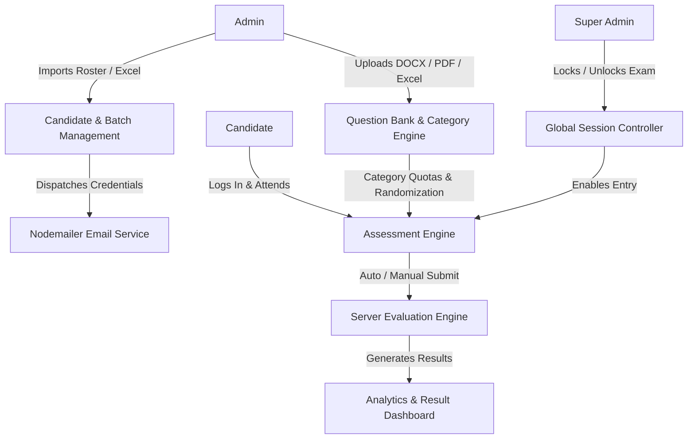

# Examination System — SaaS Platform Architecture & Project Summary

> **Version:** 1.0.0 Enterprise Edition  
> **Framework:** Next.js 15 (Turbopack) & React 19  
> **Database:** PostgreSQL with Prisma ORM 6  
> **Styling:** Tailwind CSS (Custom Enterprise Design System)  
> **Branding:** Global Minds — Build Skills | Own the Future  

---

## 1. Executive Summary

The **Examination System SaaS** is a high-concurrency, enterprise-grade assessment platform designed for universities, educational institutions, training organizations, and corporate recruitment pipelines. It facilitates secure end-to-end examination lifecycles: from candidate onboarding and batch provisioning to AI-balanced question authoring, real-time supervised exam sessions, automatic server-side evaluation, and detailed analytics reporting.

---

## 2. Technology Stack & Architecture

| Layer | Technology | Purpose & Details |
| :--- | :--- | :--- |
| **Frontend Framework** | **Next.js 15.2+ (App Router)** | Server Components, Client Hydration, Turbopack compilation |
| **UI Library** | **React 19** | Concurrent rendering, modern hooks, transitions |
| **Styling & Design** | **Tailwind CSS 3.4** | Custom modern light-theme enterprise palette, zero-clipping components |
| **Icons & Visuals** | **Lucide React & Canvas-Confetti** | Clean SVG icon set, completion milestone celebration animations |
| **Database & ORM** | **PostgreSQL + Prisma ORM 6.4** | Strongly-typed relational data models, automated migrations, connection pooling |
| **Authentication & Security** | **BcryptJS + Jose (JWT)** | Secure password hashing, HTTP-only secure cookie sessions, RBAC middleware |
| **Document Parsers** | **XLSX, Mammoth (.docx), PDF-Parse, PDF-Lib** | Multi-format bulk import/export for questions and candidate rosters |
| **Email Service** | **Nodemailer** | Automated candidate credential dispatch and exam status notifications |
| **Validation** | **Zod 3.24** | Strict schema validation on all API endpoints and forms |

---

## 3. Role-Based Access Control (RBAC)

The application enforces strict access controls across 3 distinct tiers:

### 👑 Super Administrator (`SUPER_ADMIN`)
* **Global Session Controller:** Master kill-switch to lock or initiate the examination platform worldwide.
* **Administrator Provisioning:** Exclusive authority to provision, inspect, deactivate, or manage sub-administrators.
* **Universal Audit:** Complete visibility into all batches, candidate attempts, question banks, and platform metrics across all administrators.
* **Permanent Protection:** Protected system accounts immune to accidental deletion or deactivation.

### 🛡️ Administrator (`ADMIN`)
* **Candidate Management:** Single student registration and bulk Excel/CSV candidate import with auto-generated credentials.
* **Batch Organization:** Organization of candidates into distinct batches with custom metadata.
* **Question Bank Operations:** Upload and parse questions from Word (.docx), PDF, Excel, and CSV files; manage question categories and quotas.
* **Exam Monitoring & Results:** Real-time visibility into student attempts, scores, and re-take permissions.
* **Exporting Reports:** Download complete assessment performance reports in Excel/CSV formats.

### 🎓 Candidate / Student (`USER`)
* **Exam Attendance:** Authenticated portal to take scheduled assessments once unlocked by the Super Admin.
* **Category-Balanced Randomized Tests:** Questions shuffled uniquely per student to prevent collusion.
* **Security & Proctoring:** Locked window, answer obfuscation (answers are never exposed in browser network payloads during active tests).
* **Live Timer & Deadline Engine:** Server-synchronized countdown with automatic submission on expiration.
* **Instant Scorecard:** Immediate score summary upon submission with category-by-category performance breakdowns.

---

## 4. Key Functional Modules



### 1. Global Session Controller
* Master toggle that prevents candidates from starting or previewing tests until the Super Admin formally initiates the session.
* Visual live indicators with pulsing status badges and real-time state synchronization across all connected sessions.

### 2. Candidate Onboarding & Batch Import
* Drag-and-drop file upload for candidate rosters (`.xlsx`, `.csv`).
* Automated deduplication by email address, validation of contacts, and creation of `UserBatch` records.
* Instant generation of randomized secure passwords.
* One-click bulk email dispatch of personalized login links and credentials to all candidates in a batch.

### 3. Smart Question Bank & Parser Pipeline
* Supports multi-format question imports:
  * **Microsoft Word (`.docx`)** via `mammoth`
  * **Adobe PDF (`.pdf`)** via `pdf-parse`
  * **Excel / CSV (`.xlsx`, `.csv`)** via `xlsx`
* Automated regex key extraction matching options (`A)`, `B)`, `C)`, `D)`) and correct answer indicators (`Answer: B`).
* Tagging by category (e.g., Mathematics, Logic, Verbal, Technical) and difficulty (`EASY`, `MEDIUM`, `HARD`).

### 4. Dynamic Assessment Delivery Engine
* **Category Quota Enforcement:** Dynamically selects specific quantities of questions from designated categories (e.g., 20 Aptitude, 15 Coding, 15 English).
* **Zero-Leakage Architecture:** Correct answers and grading rubrics are strictly evaluated on the server side; frontend clients only receive sanitized question text and option keys.
* **Answer Persistence:** Live answer recording per question (`AssessmentAnswer`) ensures students never lose progress if a tab is refreshed.
* **Server-Backed Countdown:** `deadlineAt` timestamp ensures clients cannot tamper with client-side JavaScript timers.

### 5. Instant Evaluation & Result Analytics
* Instant calculation of attempted questions, correct count, incorrect count, unanswered count, raw score, and final percentage.
* Interactive celebratory user interface with confetti animations upon successful completion.
* Administrator result tables with single-click retake granting, search filters, and batch filtering.

---

## 5. Database Schema & Data Models

The PostgreSQL database (managed via Prisma) is normalized and indexed for high-volume concurrency:

| Model | Purpose | Key Relationships |
| :--- | :--- | :--- |
| **`User`** | Stores Super Admins, Admins, and Candidates | Belongs to `UserBatch`, relates to `Assessment`, `Category`, `Question` |
| **`UserBatch`** | Tracks batch imports of candidate cohorts | Has many `User` records |
| **`Category`** | Subject classification with target question quotas | Relates to `Question` |
| **`Question`** | Assessment questions with difficulty and source file | Has many `QuestionOption`, relates to `Category` |
| **`QuestionOption`** | Multiple choice options (A, B, C, D) | Belongs to `Question` |
| **`ImportBatch`** | Historical records of question document imports | Relates to `Question` |
| **`Assessment`** | Individual student exam session and final score | Has many `AssessmentQuestion` and `AssessmentAnswer` |
| **`AssessmentQuestion`** | Questions assigned to a specific student attempt | Pairs `Assessment` and `Question` with unique sequence order |
| **`AssessmentAnswer`** | Recorded candidate response per question | Pairs `Assessment` and `Question` with chosen option |
| **`ExamControl`** | Global singleton controlling exam active state | Tracks status and triggering Super Administrator |

---

## 6. Directory Structure Overview

```text
Examination System - SaaS/
├── prisma/
│   ├── schema.prisma           # Complete database model definitions
│   └── seed.ts                 # Database seeding script for development
├── public/
│   ├── logo.png                # Official Global Minds enterprise logo
│   └── logo.jpg                # High-resolution brand asset
├── src/
│   ├── app/
│   │   ├── admin/              # Administrator portal pages
│   │   │   ├── categories/     # Category quota configuration
│   │   │   ├── dashboard/      # Admin metric overview and live controllers
│   │   │   ├── questions/      # Question bank manager & multi-format importer
│   │   │   ├── results/        # Candidate result inspection & CSV export
│   │   │   └── users/          # Candidate management, batch filters & modal actions
│   │   ├── api/                # Next.js Server Route Handlers
│   │   │   ├── admin/          # Admin APIs (batches, questions, users, export)
│   │   │   ├── assessments/    # Exam lifecycle (start, save answer, submit, status)
│   │   │   └── auth/           # Login, logout, session verification
│   │   ├── login/              # Unified enterprise authentication page
│   │   └── user/               # Candidate portal
│   │       ├── assessment/     # Secure live test-taking environment
│   │       └── dashboard/      # Student welcome and score history page
│   ├── components/
│   │   ├── app-layout.tsx      # Sidebar and navigation wrapper
│   │   ├── custom-dropdown.tsx # Floating popover select with checkmarks & counts
│   │   └── navbar.tsx          # Top bar with user profile & active badge
│   └── lib/
│       ├── auth/               # JWT token utilities & password cryptography
│       ├── db.ts               # Global Prisma client singleton instance
│       ├── parsers/            # Document parsing engines (DOCX, PDF, XLSX, CSV)
│       └── services/           # Decoupled business logic services:
│           ├── assessment.service.ts
│           ├── email.service.ts
│           ├── evaluation.service.ts
│           ├── exam-control.service.ts
│           ├── question.service.ts
│           └── user-import.service.ts
└── tailwind.config.ts          # Custom theme configuration
```

---

## 7. Security, Scalability & Performance Highlights

1. **Anti-Cheating Mechanisms:**
   * Category question randomization prevents neighboring candidates from receiving the same question sequence.
   * Full-screen and focus monitoring hooks to discourage window switching during active exams.
2. **Server-Side Evaluation Integrity:**
   * Correct answers are strictly isolated in server databases.
   * Assessment submission runs atomic transactions to prevent double submissions or race conditions.
3. **Database Performance Indexing:**
   * Strategic indexes on `[userId, status]`, `[batchId]`, `[createdAt]`, and composite unique constraints on `[assessmentId, questionId]` for sub-millisecond query responses under load.
4. **Resilient Document Ingestion:**
   * Multi-strategy regex parsers tolerate messy formatting in Word and PDF uploads.

---

## 8. Summary of Recent UI/UX Enhancements

* **Floating Custom Dropdowns:** Replaced native OS drop-down selects with floating popover menus with search counts, checkmarks, and smooth scrollbars.
* **Sleek Light Theme:** Modernized the Global Session Controller and action buttons to a cohesive, light pastel enterprise aesthetic.
* **Responsive Non-Clipping Layouts:** Streamlined toolbar controls, eliminated horizontal scrollbars, and prevented text wrapping across all viewport sizes.
* **Official Branding Integration:** Global Minds branding incorporated seamlessly across headers, login screens, email dispatch templates, and candidate dashboards.
